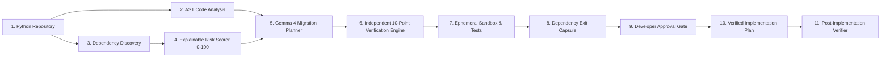

# Exit Capsule Generator
> **AI-Powered Python Dependency Resilience and Migration Planning Tool**
>
> **Product Principle:** *AI proposes. The tool verifies. The developer approves. Tests provide evidence.*

[](https://www.python.org/)
[](LICENSE)
[](https://fastapi.tiangolo.com/)
[](https://react.dev/)

---

## 1. What is Exit Capsule Generator.?

**Exit Capsule Generator** is a developer tool that analyzes local Python repositories, identifies dependency maintenance risks, maps dependency usage in source code via static Python Abstract Syntax Tree (AST) analysis, formulates structured migration proposals powered by **Gemma 4**, independently verifies those proposals in isolated virtual environments, and produces a tamper-evident **Dependency Exit Capsule** (`capsule.json` and `capsule.md`).

Upon developer review and explicit approval, the engine generates an evidence-backed **15-point Implementation Plan** and a copy-paste directive for AI coding agents (Cursor, Claude, Copilot, Gemini).

---

## 2. Technology Stack

| Layer | Technology |
|---|---|
| **Backend Language** | Python 3.12+ |
| **Web Framework** | FastAPI 0.110+ (served by Uvicorn ASGI) |
| **Data Validation & Settings** | Pydantic 2 & pydantic-settings |
| **Outbound HTTP** | httpx |
| **Static Code Analysis** | Python standard library `ast` module (no code execution) |
| **Version & Package Logic** | packaging (PEP 440 / PEP 503 normalization) |
| **Database** | SQLite (zero-config, local-first storage) |
| **AI Models** | Gemma 4 / Gemini via OpenAI-compatible APIs or local Ollama |
| **Frontend** | React 18 + TypeScript 5.5 |
| **Frontend Build Tooling** | Vite 5 (dev server proxies `/api` → backend on port `8000`) |
| **UI Animation** | Framer Motion |
| **Icons** | Lucide React |
| **Backend Tests** | pytest & pytest-asyncio |
| **Frontend Tests** | Vitest |

> All repository analysis runs **locally on your machine**. Your source code is never uploaded to third-party services; only bounded metadata snippets are shared with the AI provider when AI planning is explicitly enabled.

---

## 3. Core Capabilities & Architectural Workflow



1. **Static AST Analysis**: Never executes repository code during scanning. Tracks imports, bindings, call expressions, and enclosing function/class scopes (`ServiceClient::fetch_data`).
2. **Deterministic Risk Scoring**: 0 to 100 explainable score combining release age, major/minor version lag, yanked release flags, and legacy Python incompatibilities.
3. **Gemma 4 Migration Engine**: Tailored prompts sending bounded AST usages and project constraints to Gemma 4 (`google/gemma-4-27b-it` or `gemma4:latest`).
4. **Independent 10-Point Verification Pipeline**: Empirically confirms PyPI existence, checks Python constraints, attempts clean installation in an ephemeral virtual environment, inspects module exports, compares AST symbol coverage, and executes baseline tests.
5. **Dependency Exit Capsule**: Produces versioned `capsule.json` and rich `capsule.md` with an immutable evidence ledger classifying every claim (`observed`, `executed`, `verified`, `ai_suggested_unverified`, `rejected`, `inconclusive`, `not_run`).
6. **Developer Approval Gate**: Enforces explicit human-in-the-loop authorization before migration plans or patches are generated.
7. **Verified Implementation Planner**: Emits a 15-point roadmap, interactive checklist, and AI coding agent prompt.
8. **Post-Implementation Verification**: Analyzes modified working copies, computes unified diffs, verifies import removal/addition, and links verification outcomes to the capsule.

---

## 4. AI Usage & Gemma 4 Integration

Exit Capsule Generator follows an **AI-assisted, verification-first** philosophy: *AI proposes. The tool verifies. The developer approves.* AI is used for exactly one purpose — proposing migration targets — and every AI claim must survive independent empirical verification before it reaches your implementation plan.

### 4.1 What AI Does (and Does Not Do)

| Pipeline Stage | AI Involved? |
|---|---|
| Dependency discovery & static AST analysis | **No** — pure deterministic static analysis |
| Explainable risk scoring (0–100) | **No** — rule-based scoring with factor contributions |
| **Migration proposal generation** | **Yes — Gemma 4 / Gemini** |
| Independent 10-point verification | **No** — empirical checks in ephemeral virtual environments |
| Implementation plan & AI agent directive | **No** — assembled from verified evidence only |

### 4.2 Supported AI Providers

| Option | Endpoint | Example Model |
|---|---|---|
| Google Gemini API | `https://generativelanguage.googleapis.com/v1beta` | `gemini-2.5-flash` |
| Together AI (OpenAI-compatible) | `https://api.together.xyz/v1` | `google/gemma-4-27b-it` |
| Local Ollama (zero cloud exposure) | `http://localhost:11434/v1` | `gemma4:latest` |

### 4.3 How the AI Adapter Works

- Sends a **strictly schema-bound prompt** containing the target dependency, deterministic risk evidence, project Python constraints, and up to **10 bounded AST usage snippets** (file, line, referenced symbol, call expression, enclosing scope) — never your full source code.
- Requires the model to respond with **strict JSON** validated against the `GemmaMigrationProposal` Pydantic schema (candidate replacement, reasons, migration steps, expected API differences, difficulty, confidence explanation, assumptions).
- Parses responses defensively (markdown code-fence stripping, brace extraction) with **2 bounded retries** and a **30-second timeout**.
- Validates that the configured model belongs to the **Gemma / Gemini family**; incompatible models (e.g. `gpt-4o`, `claude-3-opus`) raise an explicit `AIConfigurationError` instead of silently substituting.

### 4.4 Trust & Safety Guarantees

- **Optional by design**: with no API key configured, the platform runs in fully **deterministic mode** — scanning, risk scoring, verification, and capsule generation all remain 100% functional without AI.
- **Evidence ledger**: every AI-generated claim is recorded as `ai_suggested_unverified` in the capsule until the verification engine empirically confirms it.
- **Human-in-the-loop**: no migration plan or patch is generated without explicit developer approval at the review gate.
- **Secret hygiene**: `GEMMA_API_KEY` is stripped from subprocess environments and redacted from logs, databases, and generated capsules.

See [docs/GEMMA_MODEL_GUIDE.md](docs/GEMMA_MODEL_GUIDE.md) for complete provider configuration instructions.

---

## 5. Quick Start & Local Setup

### Prerequisites
- Python 3.12 or 3.13
- Node.js v18+ (for frontend development or building the UI)

### Step 1: Clone and Configure Environment
```bash
git clone https://github.com/Paritosh2681/H26_Lexacore_Exit-Capsule-Generator.git
cd H26_Lexacore_Exit-Capsule-Generator

# Copy environment configuration
cp .env.example .env
```

Configure your `.env` settings:
```ini
# Optional: To enable Gemma 4 AI planning (system works 100% deterministically without it)
GEMMA_API_KEY=your_api_key_here
GEMMA_API_BASE_URL=https://api.together.xyz/v1
GEMMA_MODEL=google/gemma-4-27b-it
```

### Step 2: Install Backend Dependencies
```bash
cd backend
pip install -r requirements.txt
```

### Step 3: Run Backend & Web Application
The FastAPI backend serves both the API endpoints and the built frontend UI directly:
```bash
python -m uvicorn app.main:app --host 127.0.0.1 --port 8000 --reload
```
Open your browser to: **`http://127.0.0.1:8000`**

*(Optional) For frontend active development with hot-reload:*
```bash
cd frontend
npm install
npm run dev
```
Open **`http://localhost:5173`**

*(Optional) Build the frontend for production so FastAPI serves the UI directly at `http://127.0.0.1:8000`:*
```bash
cd frontend
npm install
npm run build
```
The build output in `frontend/dist` is mounted automatically by the FastAPI backend on next server start.

---

## 6. Running the Automated Test Suite

The project includes unit and integration tests with 100% passing coverage across all subsystems:

```bash
cd backend
python -m pytest -v
```

Tests verify:
- Path traversal prevention & command execution timeouts
- PEP 503 package normalization & requirement parsing (`requirements.txt`, `pyproject.toml`)
- AST usage extraction, alias tracking, and enclosing scope attribution
- Deterministic risk score calculations and factor contributions
- Gemma 4 client model validation and structured JSON parsing
- Independent 10-point verification engine and API symbol matching
- Exit Capsule schema validation and markdown generation
- Developer review, approval gates, and 15-point implementation plan builder
- Post-implementation unified diff and verification reporting
- Full end-to-end workflow execution

---

## 7. Walkthrough: Generating a Genuine Capsule from LinkWatch

Follow these steps to analyze the organizer-provided `LinkWatch` repository (or the included sample test fixture):

1. **Start the Application**: Navigate to `http://127.0.0.1:8000`.
2. **Click "New Scan"**:
   - In the repository path field, enter the path to the `LinkWatch` repository (or click *"Use Sample Test Fixture"*).
   - If Gemma 4 is configured, check *"Enable Gemma 4 Migration Planner"*.
   - Click **"Launch Scan Pipeline"**.
3. **Inspect Inventory & Risk**:
   - The scanner displays the dependency inventory, identifying declared dependencies (e.g. `requests`, `pyyaml`), candidate undeclared dependencies, and candidate unused dependencies.
   - Click **"Inspect & Plan"** on `requests` (Risk Score: Medium).
4. **Run Independent Verification**:
   - In the dependency details page, review AST usage locations (e.g. `requests.get` inside `URLWatcher::check_health`).
   - In the Verification panel, set candidate package to `httpx` and click **"Run Verification"**.
   - Watch the independent 10-point check suite execute, confirming PyPI existence, Python compatibility, clean venv installation, and symbol exports.
5. **Review & Approve**:
   - Enter your notes in the Developer Review Gate and click **"Approve Migration"**.
6. **Generate Verified Implementation Plan**:
   - Click **"Proceed to Implementation Planner"**.
   - Review the 15-point migration checklist.
   - Click **"Copy Directive"** to copy the ready-to-use prompt for your AI coding agent.
7. **Download Capsule**:
   - Click **"View Exit Capsule"** to download `capsule.json` and `capsule.md`.

---

## 8. Security & Sandboxing Architecture

- **No Remote Code Uploads**: Source code is analyzed locally on your machine.
- **Subprocess Safety**: All subprocess commands are executed with `shell=False`, array-passed arguments, strict execution timeouts (default: 120s), and byte output caps (512 KB).
- **Filesystem Isolation**: Tests run in temporary working copies (`temp_workspaces/`); your original repository remains untouched.
- **Secret Redaction**: API keys and tokens are stripped from logs, databases, and generated capsules.

See [docs/SECURITY.md](docs/SECURITY.md) for complete details.

---

## 9. Documentation & References

- [System Architecture](docs/ARCHITECTURE.md)
- [Capsule Schema & Evidence Ledger](docs/CAPSULE_SCHEMA.md)
- [Security & Sandboxing Model](docs/SECURITY.md)
- [Gemma 4 Model Guide](docs/GEMMA_MODEL_GUIDE.md)
- [Sample LinkWatch Capsule JSON](examples/linkwatch_sample_capsule.json)
- [Sample LinkWatch Capsule Markdown](examples/linkwatch_sample_capsule.md)
- [Sample Implementation Plan](examples/linkwatch_sample_plan.md)

---

## 10. License

Licensed under the [Apache License, Version 2.0](LICENSE).
